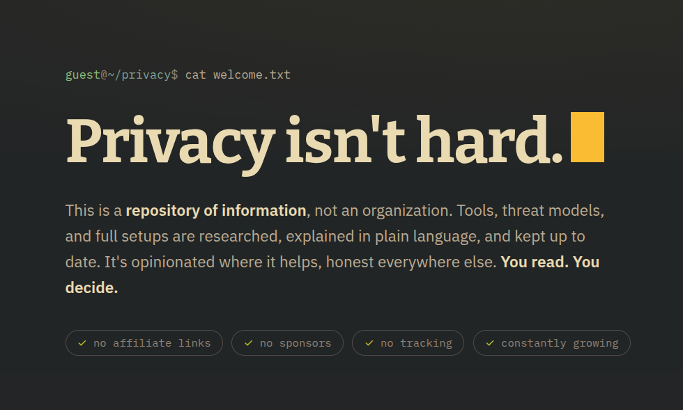

<p align="center">
  <a href="https://guides.willbara.dev">
    
  </a>
</p>

## Tool categories

| Theme | Categories |
|---|---|
| **Network & Browsing** | Browsers & Search · DNS & Network · VPNs · Anonymizing Networks |
| **Credentials & Identity** | Password Managers · 2FA & Hardware Keys · Alias Services · Personal Data Removers |
| **Communication** | Messengers · Email Providers · Social Media · Communities · Frontends |
| **Data & Files** | Cloud Storage & Sync · Notes · File Sharing · Office Suites · Encryption |
| **Platforms** | Mobile OS · Desktop OS |
| **Money & Connectivity** | Financial Services · Cellular Services |
| **Other** | AI Tools · Maps · Resources |

## Conventions

- **Verdict tags, not rankings.** Tags like *"the default pick"* or *"the
  anonymity pick"* say who a tool is for, not which tool is "best." A pick
  further down a page isn't worse, it's for someone else.
- **Attribute pills are a controlled vocabulary**, not free text. Every pill
  across the site draws from one shared, canonical list
  ([`dictionary.md`](dictionary.md)), capped at five per entry so a card
  stays scannable at a glance.
- **Good / Mind the** instead of pros/cons.
- **Price always shown**, even when free.
- **Dates everywhere.** The changelog is the credibility mechanism: when the
  facts change, the page changes, and you can watch it happen.

## Repo layout

```
.
├── index.html              landing page
├── threat-modeling.html    start-here guide
├── tools/                  one page per tool category (+ index)
├── setups/                 beginner / standard / hardened setups (+ index)
├── changelog.html          dated recommendation changes
├── about.html              who runs this, and the rules
├── 404.html
├── style.css               all shared styling, loaded by every page
├── site-search/            header search: index generator, index, and script
│   └── SERVICES.md         source-of-truth mirror of every service entry
├── icons/                  service icons, referenced as [service-name].svg
├── meta/                   favicons, web manifest, README banner
├── dictionary.md           canonical attribute-pill vocabulary
└── agent-style-standard.md voice & style standard for entry prose
```

## Tech

Pure static HTML and CSS, no backend. All shared styling lives in one
`style.css`: Gruvbox dark palette, with **Bitter**, **IBM Plex Sans**, and
**IBM Plex Mono** via Google Fonts.

Site-wide search lives in `site-search/`, matching against service names,
categories, and pills, with results dropping down from the header on every
page. The index (`site-index.js`) is generated from `SERVICES.md`; after
changing a service entry, regenerate it:

```sh
python3 site-search/build_index.py
```

Responsive down to phone widths (the sidebar collapses to pill chips, then a
hamburger nav), keyboard accessible, and respects `prefers-reduced-motion`.

## Running locally

No build step. Open `index.html` in a browser, or serve the folder:

```sh
python3 -m http.server
```

then visit <http://localhost:8000>.

## License

Content (all `.html` and `.md` pages, including card and prose text) is
licensed under [CC BY-SA 4.0](LICENSE). Code (CSS, JavaScript, and Python)
carries no separate license grant.
